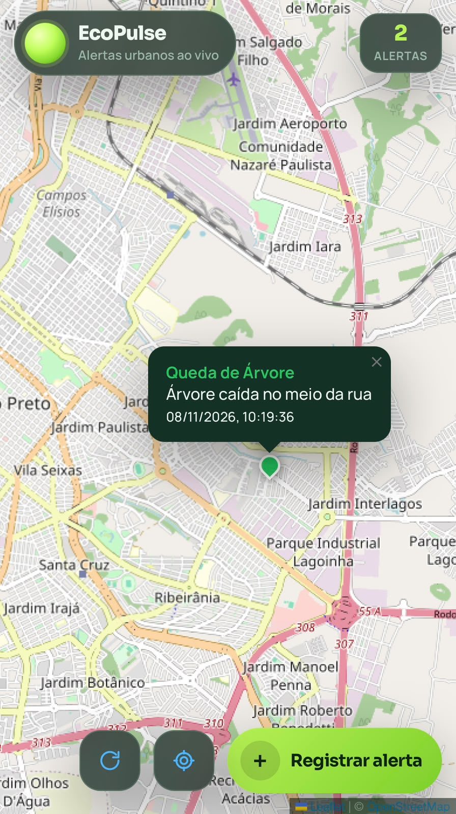
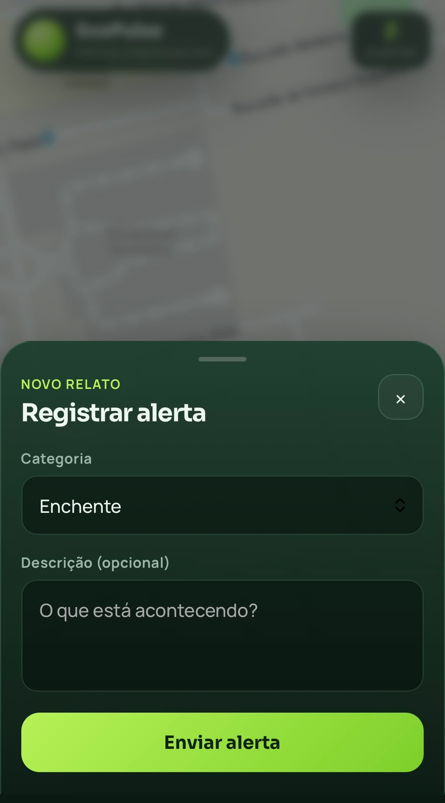

# EcoPulse

College project MVP (Minimum Viable Product).

EcoPulse is a simple web app to report and view urban alerts on a map: flood, fire, earthquake, blocked road, and fallen tree.

## What it does

- Shows your position on a map
- Lists nearby alerts (about 100 km)
- Lets you create a new alert with GPS
- Stores reports in PostgreSQL
- Uses RabbitMQ so the API answers fast and a worker saves the data

## Stack

- Frontend: React + Vite + Leaflet
- Backend: Node.js + Express
- Database: PostgreSQL
- Queue: RabbitMQ
- Docker Compose for Postgres and RabbitMQ

## How to run

### 1. Requirements

- Node.js LTS
- npm
- Docker Desktop

### 2. Env files

```bash
cp .env.example .env
cp backend/.env.example backend/.env
```

Fill in the empty values. Do not commit `.env` files.

### 3. Start services

```bash
docker compose up -d
npm run setup
```

### 4. Start the app

Terminal 1:

```bash
npm run dev:backend
```

Terminal 2:

```bash
npm run dev:frontend
```

- App: http://localhost:5173
- API: http://localhost:3000

## Main API routes

- `POST /api/reports` — create alert (returns 202, then worker saves it)
- `GET /api/reports?lat=&lon=&radiusKm=100` — list nearby alerts
- `GET /api/report-types` — list alert categories

## Notes

- This is an MVP for college, not a production system.
- Alerts older than 24 hours are deleted automatically.
- The frontend refreshes the alert list every 10 seconds.

## Screenshots





